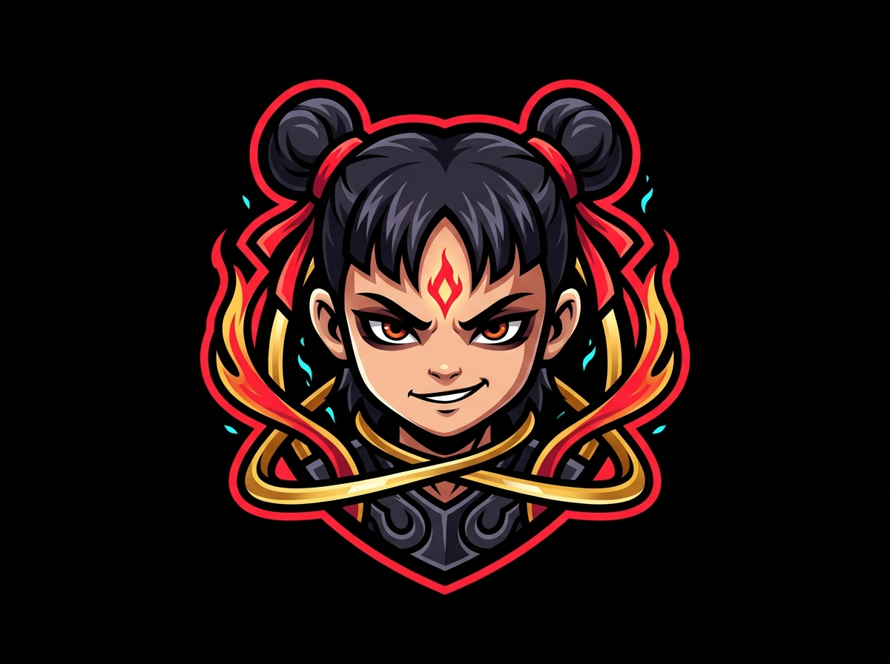

<p align="center">
  
</p>

<h1 align="center">🔥 Nezha Cyber (哪吒网络安全)</h1>

<p align="center">
  <strong>Portable ESP32 Hardware Security, RF/Wireless Research &amp; 哪吒魔童 Cyber OS</strong><br />
  <em>"My fate is mine, not heaven's!" — 我命由我不由天</em>
</p>

<p align="center">
  <strong>English</strong> | <a href="./README_ZH.md">简体中文</a>
</p>

<p align="center">
  <strong>Author &amp; Maintainer:</strong> 钟智强 (<a href="https://github.com/ctkqiang">ctkqiang</a>) ·
  <strong>License:</strong> AGPL-3.0
</p>

---

## ⚡ About This Project & Standalone Fork Philosophy

**Nezha Cyber (哪吒网络安全)** is an **independent, standalone fork of [Bruce Firmware](https://github.com/pr3y/Bruce)**, created and maintained by **钟智强 (ctkqiang)**.

We intentionally **preserve the full upstream Git commit history** and deeply respect the pioneering open-source work of the Bruce Firmware team and community. However, **Nezha Cyber diverges as a standalone project because our product philosophy is fundamentally different**:

- **Craft-First Industrial Hardware OS**: Every screen—launcher, menus, keyboard, radar, BLE tools, theme studio, and settings—is engineered around a cohesive, high-contrast dark obsidian hardware interface with zero cluttered legacy UI.
- **Native 哪吒魔童 (Nezha Demon Child) Brand Identity**: Built from the ground up around authentic Chinese mythological cybersecurity aesthetics—boot splash emblem, **20 curated 哪吒魔童 theme packs** (71 total palettes), **3 selectable Motong UI crests**, and live Theme Studio preview.
- **Original Standalone Nezha Cyber Pet (哪吒宠物)**: Replaced legacy `Brucegotchi` / `PwnGrid` / `Megalodon` with a 100% original persistent **哪吒魔童** companion featuring 4 visual evolution realms and purely passive RF spirit patrol.
- **Chinese & English First-Class Experience**: Built-in compact 12px/16px PROGMEM CJK bitmap font pipeline (`1,050+` translated UI strings) with instant EN / 简体中文 switching and full support for **4 MB Flash** boards (such as M5StickC Plus 1.1) alongside **16 MB + 8 MB PSRAM** flagship boards (LilyGO T-Deck / T-Deck Plus).
- **Daily Flipper-Style Hardware Toolkit**: Expanded beyond red-team utilities into an everyday multi-tool featuring a Sub-GHz Frequency Analyzer, Universal IR Remote, GPIO Pin Controller & Voltage Monitor, RFC 6238 TOTP 2FA Authenticator, PWM Signal Generator, ITU Morse TX, Hardware TRNG Password Generator, and Polyhedral Dice Roller.

---

## ✨ Flagship Features

### 🎨 哪吒魔童 Theme Studio & 7 Launcher Layouts
- **Live Visual Theme Studio** (`Config → Display & UI → Nezha Themes`): Interactive full-screen gallery with live **哪吒魔童** medallion, color swatches, and 1-tap apply across **20 lore-accurate 哪吒魔童 packs** (71 total color palettes):
  - *Nezha Motong (魔丸赤焰)* · *Hun Tian Ling (混天绫)* · *Wind-Fire Wheels (风火轮)* · *Qiankun Ring (乾坤圈)* · *Fire-Tipped Spear (火尖枪)* · *Lotus Rebirth (莲花化身)* · *Demon Orb Seal (魔丸封印)* · *Spirit Pearl AoBing (灵珠敖丙)* · *Ice & Fire Clash (冰火双生)* · *Dragon Palace Sea (东海龙宫)* · *Chentang Pass (陈塘关)* · *Heavenly Tribulation (天劫神雷)* · *Shanhe Scroll (山河社稷)* · *Taiyi Immortal (太乙仙风)* · *Shen Gongbao (申公豹)* · *Six-Arm Awakened (三头六臂)* · *Jade Void Palace (玉虚宫)* · *Demon Sea Rage (魔童闹海)* · *Nezha Crimson* · *Nezha Lotus*.
- **Selectable UI Crests** (`Config → Display & UI → Theme Crest`): `Motong Flame (魔童烈焰)`, `Lotus Seal (莲花玄印)`, `Ice-Fire Twin (冰火双生)`, or `Minimal (极简硬件)`.
- **7 Main Menu Layouts** (`Config → Display & UI → Menu Layout`): `Grid`, `Carousel`, `List`, `Cards`, `Dock`, `Split`, and `Compact Grid`—with full touch, trackball, keyboard, and 3-button navigation.

### 🐾 Original Nezha Cyber Pet (哪吒宠物)
- Persistent NVS stats (`Level`, `XP`, `Spirit`, `Mood`, `Bond`, `Patrols`, `RF Absorbed`).
- **4 Evolution Realms**: *Demon Orb (魔丸灵童)* → *Lotus Form (莲花化身)* → *Wind-Fire (风火少年)* → *Cyber Nezha (哪吒三太子)* with progressive visual aura, lotus pedestal, spinning Wind-Fire Wheels, and Qiankun Halo.
- **5 Interactive Actions**: **Feed (喂食)** · **Train (修炼)** · **Pet (互动)** (or tap Nezha directly!) · **Patrol (巡查)** (passive ambient Wi-Fi RF sensing) · **Rest (打坐)**.
- Runs natively on **both** LilyGO T-Deck (320×240) and M5StickC Plus 1.1 (240×135).

### 📡 Tactical Radar & RF / Wireless Security Suite
- **Tactical Radar**: Real-time Wi-Fi & BLE spatial radar sweep with AirTag/SmartTag/Evil-Twin/Hack-Device threat flagging, global GPS/RF LocationState, and toggleable **Sonar Beep** (`Config → Audio Config → Radar Beep`, ON by default).
- **Wi-Fi Tools**: AP/STA mode, Sniffer, Channel Analyzer, Jam Detect, Probe Monitor, LAN Port & Banner Audit, IDS Watchdog, Security Auditor, Evil Portal, NetCut, Responder, ARP Scanner, WireGuard, SSH/Telnet, SOCKS4 Proxy, WiFi Pass Recovery.
- **BLE Tools**: Redesigned touch-scrollable BLE Spam Suite (iOS / Android / Samsung / Windows / All), BLE Scan, GATT Inspector & Notify Viewer, BLE File Transfer, BadBLE / BLE Keyboard.
- **Sub-GHz RF (CC1101 / RF433)**: **Sub-GHz Frequency Analyzer** (315/433.92/868.35/915 MHz RSSI sweep + peak hold), Spectrum, Waterfall, Record/Replay, ProtoPirate, Custom SubGHz.
- **IR / RFID / NFC / LoRa / FM / NRF24**: **Universal IR Remote** (TV / AC / Audio / Projector one-tap blaster), TV-B-Gone, Custom IR, PN532 / PN532Killer / Chameleon / Amiibolink, LoRa, FM Radio, 2.4G Spectrum.

### 🛠️ Flipper-Style Daily Tools & Wire Tools
- **Flipper Tools** (`Others → Flipper Tools`): RFC 6238 **TOTP 2FA Authenticator**, **PWM Signal Generator**, **ITU Morse Code TX**, **Hardware TRNG Password Generator**, and **Polyhedral Dice Roller**.
- **Wire Tools**: **GPIO Pin Controller & Live ADC Voltage Monitor**, UART Terminal, I2C Scanner/Dump, SPI Flash JEDEC Console, JTAG Scanner, Continuity Multimeter.
- **WebUI & Standalone Extras**: Modernized **Nezha Cyber WebUI** (`NezhaNet` / `nezhanet`), JS Interpreter, Phone Suite, QR Codes, BadUSB/HID, iButton, and Serial CLI.

---

## 🚀 Quick Build & Flash

This repository includes an auto-detecting [Makefile](./Makefile) configured for **LilyGO T-Deck** (ESP32-S3, 16 MB Flash / 8 MB OPI PSRAM) and **M5StickC Plus 1.1** (ESP32, 4 MB Flash).

### 1. Using `make` (Recommended)
```sh
# Auto-detect connected T-Deck or M5StickC Plus 1.1, compile, and flash
make install

# Target specific boards directly
make tdeck            # LilyGO T-Deck (lilygo-t-deck)
make tdeck-plus       # LilyGO T-Deck Plus (lilygo-t-deck-pro)
make stickc-plus      # M5StickC Plus 1.1 (m5stack-cplus1_1)
make cardputer        # M5Stack Cardputer (m5stack-cardputer)

# Build merged binary only -> NezhaCyber-<ENV>.bin
make build ENV=lilygo-t-deck
make build ENV=m5stack-cplus1_1

# Flash merged binary directly at 0x00000
make flash-bin ENV=lilygo-t-deck
```

### 2. Using PlatformIO CLI Directly
```sh
pio run -e lilygo-t-deck
pio run -e m5stack-cplus1_1
```

### 3. LilyGO T-Deck Bootloader Mode
1. Connect T-Deck via USB-C and turn the power switch **OFF**.
2. **Press and hold the Trackball button** (`GPIO0` / `BOOT`).
3. Turn the power switch **ON** while holding the Trackball, then release.
4. Run `make tdeck` (or `pio run -e lilygo-t-deck -t upload`).

### 4. Regenerating CJK Bitmap Fonts (Developers)
Whenever you add or edit translations in [`src/core/lang_zh_cn.h`](./src/core/lang_zh_cn.h):
```sh
python3 tools/gen_cjk_font.py && python3 tools/gen_cjk_font.py --check
```

---

## 🧩 Supported Hardware

Primary verified targets for **Nezha Cyber**:
- **LilyGO T-Deck / T-Deck Plus** (`ESP32-S3`, 320×240 IPS + Touch + Trackball + QWERTY + 8 MB OPI PSRAM)
- **M5Stack M5StickC Plus 1.1** (`ESP32`, 240×135 TFT + 3 Buttons + 4 MB Flash full build)

Also inherits board definitions across the wider ESP32 ecosystem from upstream Bruce Firmware: M5Stack Cardputer / M5StickC Plus2 / Core2 / CoreS3, LilyGO T-Embed / T-Embed CC1101 / T-Display-S3 / T-Watch-S3 / T-LoRa Pager, CYD-2432S028, Elecrow, Smoochiee, and ESP32-C5 boards (see [`boards/`](./boards/) and [`platformio.ini`](./platformio.ini)).

---

## 🙏 Lineage, Upstream Credits & License

**Nezha Cyber (哪吒网络安全)** is authored and maintained by **钟智强 ([ctkqiang](https://github.com/ctkqiang))**.

This project is an independent standalone fork originating from **[Bruce Firmware](https://github.com/pr3y/Bruce)**, preserving its full Git history and AGPL-3.0 copyleft lineage. Deep gratitude to the Bruce maintainers and upstream open-source ecosystem:
- **[pr3y/Bruce](https://github.com/pr3y/Bruce)** and all upstream contributors (`@bmorcelli`, `@IncursioHack`, `@Luidiblu`, `@eadmaster`, `@rennancockles`, `@7h30th3r0n3`, `@Tawank`, `@geo-tp`, `@lshaf`, and the entire Bruce community).
- Foundational open-source inspirations: [ESP32Marauder](https://github.com/justcallmekoko/ESP32Marauder), [Launcher](https://github.com/bmorcelli/Launcher), [Evil-M5Project](https://github.com/7h30th3r0n3/Evil-M5Project), and [M5Stick-Nemo](https://github.com/n0xa/m5stick-nemo).
- Third-party library attributions and copyleft details: see [THIRD_PARTY.md](./THIRD_PARTY.md) and [LICENSE](./LICENSE).

---

## ⚠️ Legal Disclaimer

**Nezha Cyber (哪吒网络安全)** is released under the **GNU Affero General Public License v3.0 (AGPL-3.0)** strictly for **authorized security research, education, hardware debugging, and personal laboratory testing**. Any unauthorized or malicious use against systems you do not own or have explicit written permission to test is strictly prohibited. The author (**钟智强 / ctkqiang**) and upstream contributors assume no liability for misuse.
