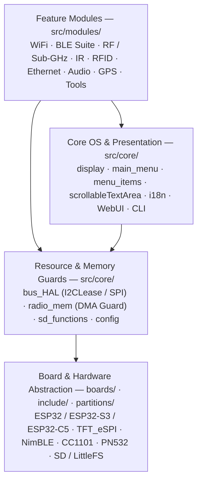

# Architecture & Repository Layout — Nezha Cyber (哪吒网络安全)

> **Language / 语言:** **English** | [简体中文 (Simplified Chinese)](ARCHITECTURE_ZH.md)  
> **Related Engineering Guide:** [Memory Architecture & Data Structures](MEMORY_AND_DATA_STRUCTURES.md) | [内存架构与数据结构指南 (ZH)](MEMORY_AND_DATA_STRUCTURES_ZH.md)

**Author & Maintainer:** 钟智强 ([ctkqiang](https://github.com/ctkqiang))  
**License:** GNU AGPL-3.0

---

## Layered Firmware Architecture

Nezha Cyber is structured in four strict layers so hardware bus arbitration, DMA memory budgets, and UI/module lifecycles remain decoupled across 4 MB non-PSRAM ESP32 boards and 16 MB OPI-PSRAM ESP32-S3 boards.



---

## Standardized Directory Tree

```text
.
├── .github/                  # CI/CD workflows (PRs target development), Issue & PR templates
│   ├── ISSUE_TEMPLATE/       # Structured YAML issue forms (Bug, Feature, Board Support)
│   ├── workflows/            # ci.yml, release.yml, manual-board-build.yml, stale.yml
│   ├── PULL_REQUEST_TEMPLATE.md
│   └── dependabot.yml
├── boards/                   # Per-board PlatformIO definitions, pinouts & hardware interfaces
├── docs/                     # Bilingual architecture, memory/data structures & roadmap docs
│   ├── ARCHITECTURE.md       # System architecture & layout (EN)
│   ├── ARCHITECTURE_ZH.md    # 系统架构与目录规范 (ZH)
│   ├── MEMORY_AND_DATA_STRUCTURES.md    # Memory & data-structure engineering guide (EN)
│   ├── MEMORY_AND_DATA_STRUCTURES_ZH.md # 内存架构与数据结构工程指南 (ZH)
│   └── ROADMAP.md
├── embedded_resources/       # WebUI static assets (auto-gzipped into include/webFiles.h)
├── include/                  # Shared headers & global hardware abstraction definitions (globals.h)
├── lib/                      # Vendored / patched embedded libraries
├── media/                    # Official 哪吒魔童 artwork, banners & hardware diagrams
├── partitions/               # Custom ESP32 / ESP32-S3 / ESP32-C5 Flash partition tables
│   ├── custom_4Mb.csv
│   ├── custom_4Mb_full.csv
│   ├── custom_4Mb_fullv2.csv
│   ├── custom_8Mb.csv
│   └── custom_16Mb.csv
├── pcbs/                     # Open-source PCB designs & hardware schematics
├── projects/                 # Standalone companion ESP32 projects
├── scripts/
│   └── build/                # PlatformIO pre/post build hooks (submodule check, patch, merge-bin)
├── sd_files/                 # Reference microSD card templates (scripts, IR, portals, themes)
├── src/
│   ├── core/                 # Core OS: display, themes, i18n, config, bus/radio guards, WebUI, CLI
│   │   ├── i18n.{h,cc}       # Bilingual lookup (en / zh-CN) & UTF-8 width wrapping
│   │   ├── lang_zh_cn.h      # Sorted ASCII-keyed PROGMEM translation table (O(log N) bsearch)
│   │   ├── cjk_font_data.h   # Generated 12x12 / 16x16 PROGMEM CJK glyph bitmaps
│   │   ├── bus_HAL.h         # Move-only RAII I2CLease & SPI bus arbitration
│   │   ├── radio_mem.h       # Two-tier DMA DRAM guards for Wi-Fi / NimBLE initialization
│   │   ├── menu_items/       # Top-level MenuItemInterface launchers
│   │   ├── serial_commands/  # Interactive serial CLI handlers
│   │   ├── tftLogger/        # Display wrapper & PROGMEM Unicode/CJK bitmap renderer
│   │   └── wifi/             # Wi-Fi manager, AsyncWebServer WebUI & WireGuard helpers
│   ├── modules/              # Feature modules (wifi, ble, rf, rfid, ir, ethernet, gps, others...)
│   └── main.cc               # Boot sequence, animated 哪吒魔童 splash & main event loop
├── tools/                    # Host developer utilities (gen_cjk_font.py, asset converters)
├── CHANGELOG.md
├── CODE_OF_CONDUCT.md
├── CONTRIBUTING.md
├── LICENSE
├── Makefile                  # Auto-detecting local build & flash developer workflow
├── platformio.ini            # Master PlatformIO build configuration (-Os -flto -Werror=odr)
├── README.md                 # English flagship documentation
├── README_ZH.md              # Simplified Chinese (简体中文) flagship documentation
├── SECURITY.md               # Responsible vulnerability disclosure & authorized-use policy
└── THIRD_PARTY.md            # Third-party libraries & upstream Bruce Firmware attribution
```

---

## Key Subsystems

### 1. Display, Theme Studio & 哪吒魔童 UI (`src/core/display.*`, `src/core/settingsColor.h`)
- Unified dark-obsidian hardware UI helpers (`uiSurfaceColor`, `uiBorderDimColor`, `uiTextBrightColor`, `uiTextOnAccentColor`, `uiDrawText16`).
- **20 curated 哪吒魔童 (Nezha Demon Child) theme packs** (`71` total palettes) + interactive full-screen **Theme Studio** (`setNezhaThemeGallery()`).
- **3 selectable 哪吒魔童 UI crests** (`Motong Flame`, `Lotus Seal`, `Ice-Fire Twin`) + **7 Main Menu layouts** (`src/core/main_menu.*`).
- Media decoders (`showJpeg`, `Gif`) use PSRAM-first buffers, bulk file I/O, and null-safe RAII teardown to keep internal DMA DRAM free and prevent leaks.

### 2. Bilingual i18n & CJK Bitmap Font Pipeline (`src/core/i18n.*`, `tools/gen_cjk_font.py`)
- **2 supported languages**: Simplified Chinese (`zh-CN`, default) and English (`en`).
- **Flash-budget tiering**:
  - 4 MB boards (`BRUCE_COMPACT_CJK_FONT`, e.g. `m5stack-cplus1_1`): compiles 12×12 PROGMEM CJK bitmaps so the full feature set fits inside `0x3E8000`.
  - 8 MB / 16 MB boards (e.g. `lilygo-t-deck`): compiles both 12×12 and 16×16 PROGMEM CJK bitmaps.
- `src/core/lang_zh_cn.h` is verified strictly ASCII-sorted for `O(log N)` binary search via `python3 tools/gen_cjk_font.py --check`.

### 3. Hardware Bus Arbitration & Radio Coexistence (`src/core/bus_HAL.h`, `src/core/radio_mem.h`)
- **Shared I2C & SPI arbitration**: Peripherals (display, SD card, CC1101, NRF24, PN532, audio/IO expander) acquire exclusive access via move-only RAII leases (`I2CLease`, `acquireSPIBus()`), preventing bus contention and pin-state corruption.
- **Two-tier DMA memory gating**: Before starting Wi-Fi or NimBLE, modules check `radioHasMemForWifi()` / `radioHasMemForBle()` / `radioSafeBleInit()` to guarantee contiguous `MALLOC_CAP_DMA` internal DRAM is available without triggering `ESP_ERR_NO_MEM` panics.

### 4. Memory Architecture & Data Structures
- Full memory-tier specifications, container patterns, concurrency rules, and audit fixes are documented in [MEMORY_AND_DATA_STRUCTURES.md](MEMORY_AND_DATA_STRUCTURES.md) ([简体中文版本](MEMORY_AND_DATA_STRUCTURES_ZH.md)).

### 5. Real-Time Diagnostics (`src/core/logging/`, `docs/LOGGING.md`)
- Android-logcat-style `V/D/I/W/E/F` logger with fixed 320-byte stack lines, no RAM history and immediate SD append/flush to `/NezhaLogs/nezha.log`.
- 512 KiB rotation, boot/reset-reason/crash banner, heap/PSRAM snapshots, recursive-mutex task safety.
- On-device live viewer (`Config → System Log`), serial CLI (`log tail/level/info/clear`) and WebUI (`/logs`, `/logs?html=1`).

### 6. Build, CI & Branching Pipeline (`scripts/build/`, `partitions/`, `Makefile`, `.github/workflows/ci.yml`)
- **Compiler & Linker policy**: `-Os -flto -ffunction-sections -fdata-sections -Wl,--gc-sections -Werror=odr` (strict One Definition Rule across translation units).
- **Partition validation**: `scripts/build/build.py` verifies firmware size against the target partition table and emits ready-to-flash merged binaries (`NezhaCyber-<env>.bin`).
- **Branch workflow**: All feature and bugfix pull requests target `development` (verified by CI across `lilygo-t-deck`, `m5stack-cplus1_1`, `m5stack-cardputer`, and `lilygo-t-embed-cc1101`); only the maintainer promotes `development` → `main`.
