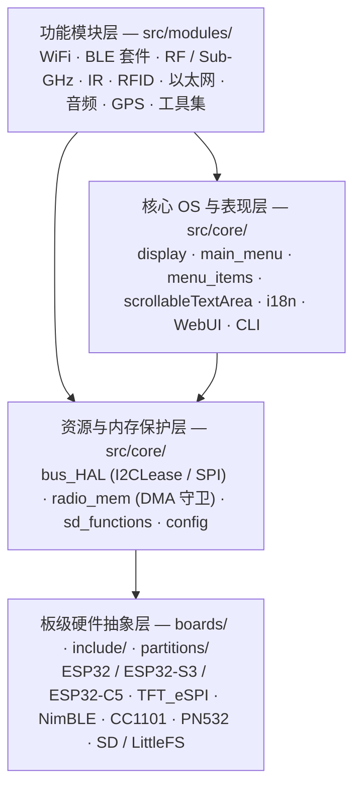

# 系统架构与仓库目录规范 — 哪吒网络安全 (Nezha Cyber)

> **语言 / Language:** [English](ARCHITECTURE.md) | **简体中文 (Simplified Chinese)**  
> **相关工程文档:** [内存架构与数据结构指南](MEMORY_AND_DATA_STRUCTURES_ZH.md) | [Memory Architecture & Data Structures (EN)](MEMORY_AND_DATA_STRUCTURES.md)

**作者与维护者：** 钟智强 ([ctkqiang](https://github.com/ctkqiang))  
**开源协议：** GNU AGPL-3.0

---

## 分层固件架构

哪吒网络安全（Nezha Cyber）采用严格的四层嵌入式架构设计，确保硬件总线仲裁、内部 DMA 内存预算以及 UI/功能模块生命周期完全解耦，从而同时兼容 4 MB 无 PSRAM 的 ESP32 开发板与 16 MB OPI-PSRAM 的 ESP32-S3 开发板。



---

## 标准化目录结构

```text
.
├── .github/                  # CI/CD 流水线（PR 目标分支为 development）、Issue 与 PR 模板
│   ├── ISSUE_TEMPLATE/       # 结构化 YAML 表单（Bug 报告、功能建议、新开发板适配）
│   ├── workflows/            # ci.yml, release.yml, manual-board-build.yml, stale.yml
│   ├── PULL_REQUEST_TEMPLATE.md
│   └── dependabot.yml
├── boards/                   # 各开发板 PlatformIO 配置、引脚定义与硬件接口
├── docs/                     # 中英双语系统架构、内存与数据结构文档、路线图
│   ├── ARCHITECTURE.md       # 系统架构与目录规范（英文）
│   ├── ARCHITECTURE_ZH.md    # 系统架构与目录规范（简体中文）
│   ├── MEMORY_AND_DATA_STRUCTURES.md    # 内存架构与数据结构工程指南（英文）
│   ├── MEMORY_AND_DATA_STRUCTURES_ZH.md # 内存架构与数据结构工程指南（简体中文）
│   └── ROADMAP.md
├── embedded_resources/       # WebUI 静态资源（构建时自动 Gzip 压缩至 include/webFiles.h）
├── include/                  # 全局共享头文件与硬件抽象定义（globals.h）
├── lib/                      # 随仓维护 / 补丁版嵌入式依赖库
├── media/                    # 哪吒魔童官方视觉素材、横幅与硬件接线图
├── partitions/               # 定制 ESP32 / ESP32-S3 / ESP32-C5 Flash 分区表
│   ├── custom_4Mb.csv
│   ├── custom_4Mb_full.csv
│   ├── custom_4Mb_fullv2.csv
│   ├── custom_8Mb.csv
│   └── custom_16Mb.csv
├── pcbs/                     # 开源 PCB 设计文件与硬件原理图
├── projects/                 # 独立配套 ESP32 工程
├── scripts/
│   └── build/                # PlatformIO 构建前后钩子（子模块检查、补丁、固件合并）
├── sd_files/                 # microSD 卡参考模板（脚本、红外码库、Portal、主题配置）
├── src/
│   ├── core/                 # 核心 OS：显示、主题、国际化、配置、总线/射频守卫、WebUI、CLI
│   │   ├── i18n.{h,cc}       # 双语查表（en / zh-CN）与 UTF-8 按像素宽度换行
│   │   ├── lang_zh_cn.h      # 严格按 ASCII 排序的 PROGMEM 译文表（O(log N) 二分查找）
│   │   ├── cjk_font_data.h   # 自动生成的 12x12 / 16x16 PROGMEM 中文字模位图
│   │   ├── bus_HAL.h         # 仅可移动 RAII 的 I2CLease 与 SPI 总线互斥锁
│   │   ├── radio_mem.h       # Wi-Fi / NimBLE 启动前两级 DMA DRAM 安全守卫
│   │   ├── menu_items/       # 顶层 MenuItemInterface 模块启动器
│   │   ├── serial_commands/  # 交互式串口 CLI 命令处理器
│   │   ├── tftLogger/        # 显示封装层与 PROGMEM Unicode/CJK 位图渲染器
│   │   └── wifi/             # Wi-Fi 管理器、AsyncWebServer WebUI 与 WireGuard 辅助
│   ├── modules/              # 功能模块（wifi、ble、rf、rfid、ir、ethernet、gps、others 等）
│   └── main.cc               # 启动流程、哪吒魔童开机动画与主事件循环
├── tools/                    # 宿主机开发脚本（gen_cjk_font.py、资源转换器）
├── CHANGELOG.md
├── CODE_OF_CONDUCT.md
├── CONTRIBUTING.md
├── LICENSE
├── Makefile                  # 自动检测串口的本地编译与烧录脚本
├── platformio.ini            # PlatformIO 主构建配置（-Os -flto -Werror=odr）
├── README.md                 # 英文主说明文档
├── README_ZH.md              # 简体中文主说明文档
├── SECURITY.md               # 负责任的漏洞披露与合法授权使用声明
└── THIRD_PARTY.md            # 第三方开源库与上游 Bruce Firmware 致谢
```

---

## 核心子系统说明

### 1. 显示引擎、主题工坊与哪吒魔童 UI (`src/core/display.*`, `src/core/settingsColor.h`)
- 统一暗曜石（Dark-Obsidian）硬件 UI 渲染辅助（`uiSurfaceColor`、`uiBorderDimColor`、`uiTextBrightColor`、`uiTextOnAccentColor`、`uiDrawText16`）。
- 内置 **20 套精选哪吒魔童主题包**（共 71 种配色方案）与全屏交互式 **Theme Studio**（`setNezhaThemeGallery()`）。
- 支持 **3 款哪吒魔童徽章**（魔童烈焰、莲华法印、冰火双生）与 **7 种主菜单布局**（`src/core/main_menu.*`）。
- 媒体解码器（`showJpeg`、`Gif`）采用 PSRAM 优先缓冲、整块文件读取（bulk `read`）与空指针安全的 RAII 生命周期管理，避免挤占内部 DMA DRAM 或泄漏句柄。

### 2. 双语国际化与 CJK 字模管线 (`src/core/i18n.*`, `tools/gen_cjk_font.py`)
- **支持 2 种语言**：简体中文（`zh-CN`，默认）与英文（`en`）。
- **Flash 预算分层**：
  - 4 MB 开发板（定义 `BRUCE_COMPACT_CJK_FONT`，如 `m5stack-cplus1_1`）：仅编译 12×12 PROGMEM 中文字模，确保完整功能集稳妥落在 `0x3E8000` 应用分区上限内。
  - 8 MB / 16 MB 开发板（如 `lilygo-t-deck`）：同时编译 12×12 与 16×16 PROGMEM 中文字模。
- `src/core/lang_zh_cn.h` 通过 `python3 tools/gen_cjk_font.py --check` 强制校验严格 ASCII 升序，保证运行时 `O(log N)` 二分查表且零动态内存开销。

### 3. 硬件总线仲裁与射频共存 (`src/core/bus_HAL.h`, `src/core/radio_mem.h`)
- **共享 I2C / SPI 总线仲裁**：屏幕、SD 卡、CC1101、NRF24、PN532、音频/IO 扩展芯片均通过仅可移动的 RAII 租约（`I2CLease`、`acquireSPIBus()`）独占访问，彻底杜绝总线竞争与引脚状态污染。
- **两级 DMA 内存闸门**：在启动 Wi-Fi 或 NimBLE 协议栈前，各模块必须通过 `radioHasMemForWifi()` / `radioHasMemForBle()` / `radioSafeBleInit()` 校验连续 `MALLOC_CAP_DMA` 内部 DRAM 余量，防止 `ESP_ERR_NO_MEM` 复位。

### 4. 内存架构与数据结构规范
- 完整的内存分层模型、数据结构模式、并发安全准则及代码审计修复记录详见 [MEMORY_AND_DATA_STRUCTURES_ZH.md](MEMORY_AND_DATA_STRUCTURES_ZH.md)（[English Version](MEMORY_AND_DATA_STRUCTURES.md)）。

### 5. 构建、CI 与分支治理 (`scripts/build/`, `partitions/`, `Makefile`, `.github/workflows/ci.yml`)
- **编译器与链接器策略**：启用 `-Os -flto -ffunction-sections -fdata-sections -Wl,--gc-sections -Werror=odr`，全项目强制执行严格单一定义规则（ODR）。
- **分区容量校验**：`scripts/build/build.py` 自动核验固件体积是否超出目标分区表并生成可直接烧录的合并镜像（`NezhaCyber-<env>.bin`）。
- **分支协作流**：所有功能与修复 PR 一律基于并指向 `development` 分支（CI 自动验证 `lilygo-t-deck`、`m5stack-cplus1_1`、`m5stack-cardputer`、`lilygo-t-embed-cc1101` 四款代表性目标板）；`development` → `main` 仅由维护者本人合并发布。
