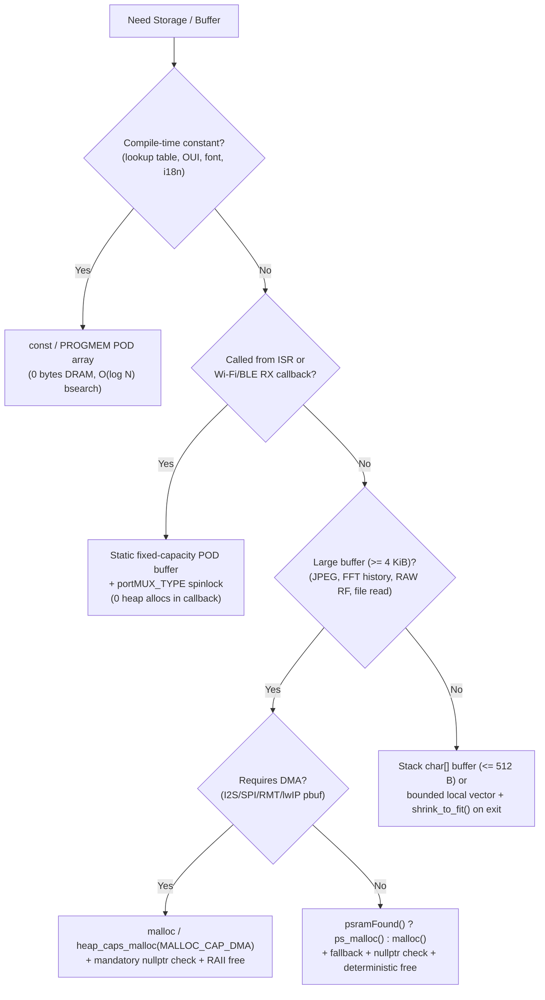

# Memory Architecture, Data Structures & Code Audit Guide

> **Language / 语言:** **English** | [简体中文 (Simplified Chinese)](MEMORY_AND_DATA_STRUCTURES_ZH.md)  
> **Related Architecture Doc:** [ARCHITECTURE.md](ARCHITECTURE.md) | [系统架构 (ZH)](ARCHITECTURE_ZH.md)

This document defines the memory hierarchy, core data-structure patterns, concurrency boundaries, zero-sluggishness performance guidelines, and concrete bug/memory audit fixes for **Nezha Cyber (哪吒网络安全)** firmware on ESP32 and ESP32-S3 hardware.

---

## 1. ESP32 / ESP32-S3 Memory Hierarchy & Board Tiers

Every firmware design decision must respect **both** board tiers simultaneously—code that works on an 8 MB PSRAM ESP32-S3 can silently panic on a 4 MB non-PSRAM ESP32 if allocation tiers or Flash budgets are ignored.

| Target Profile | Reference Boards | Flash App Budget | Internal SRAM / DMA DRAM | External PSRAM | Special Build Constraints |
| :--- | :--- | :--- | :--- | :--- | :--- |
| **16 MB + OPI PSRAM Tier** | `lilygo-t-deck` (ESP32-S3) | `custom_16Mb.csv` | ~320 KiB total DRAM (~180–240 KiB free at boot; shared by Wi-Fi, NimBLE, SPI/SD/I2S DMA) | 8 MB OPI PSRAM (`CONFIG_SPIRAM_MALLOC_ALWAYSINTERNAL=4096`) | Allocations `<= 4 KiB` land in **internal DRAM**, so small-object churn still fragments internal heap even when PSRAM has 7+ MB free! |
| **8 MB / Mid Tier** | `m5stack-cardputer`, `lilygo-t-embed-cc1101` (ESP32-S3) | `custom_8Mb.csv` / `custom_16Mb.csv` | ~320 KiB DRAM | None or 2–8 MB PSRAM depending on board | Must never assume `ps_malloc()` succeeds without fallback. |
| **4 MB No-PSRAM Tier** | `m5stack-cplus1_1` (ESP32) | `0x3E8000` (~4.0 MB max app) | ~320 KiB DRAM (~120–160 KiB free after TFT + Wi-Fi/BLE) | **None** (`psramFound() == false`) | `BRUCE_COMPACT_CJK_FONT=1`, `-Os -flto`, zero `<iostream>` bloat tolerated. |

### Allocation Decision Flow

---

## 2. Core Data Structures & Architectural Patterns

### 2.1 Zero-DRAM Flash-Resident Sorted Lookup Tables (`O(log N)`)
Never declare `static const std::pair<String, String>` or `std::map<String, ...>` lookup tables. Arduino `String` constructors allocate heap buffers in internal DRAM on first use and never release them.

- **Pattern**: Store fixed-width POD structs or `const char *` tables in Flash (`.rodata` / `PROGMEM`) and query with zero-allocation pointer/prefix comparisons or binary search.
- **Implementations**:
  - `src/core/lang_zh_cn.h` + `src/core/i18n.cc`: Strictly ASCII-sorted table queried with `O(log N)` binary search.
  - `src/modules/ble/BLE_Suite.cc` (`SAMSUNG_MAC_OUIS` + `isSamsungMacCstr()`): `O(log N)` binary search directly over `const char *` with ASCII case folding—zero temporary `String` allocations per BLE advertisement packet.
  - `src/modules/wifi/deauther.cc` (`OuiEntry kOuiList[]` + `ouiPrefixEquals()`): Replaced 38 heap-allocated `std::pair<String, String>` entries with a Flash-resident POD array and zero-copy 8-byte prefix match.

### 2.2 Lock-Safe, Zero-Allocation Radio Capture Buffers
ESP-IDF Wi-Fi promiscuous RX callbacks (`esp_wifi_set_promiscuous_rx_cb`) execute in the Wi-Fi driver task on Core 0. Calling `std::vector::push_back`, constructing Arduino `String` objects, or mutating shared UI vectors directly inside the callback risks heap corruption, priority inversion, and DRAM exhaustion.

- **Pattern**: Capture minimal fixed-width POD records into a bounded static array guarded by a `portMUX_TYPE` spinlock during RX; materialize rich UI `Host` objects once after `esp_wifi_set_promiscuous(false)`.
- **Implementation**: `src/modules/wifi/deauther.cc` (`RawDetectedClient[64]`, 512 bytes total, `portENTER_CRITICAL(&clientSnifferMux)`). Deduplicates via 6-byte `memcmp` instead of reparsing MAC strings on every frame.

### 2.3 Bounded Containers with Priority-Aware Eviction
Unbounded scan containers (`std::vector` without an upper limit) fail catastrophically in high-density RF environments (airports, offices, conferences with 200+ rotating random BLE MACs).

- **Pattern**: Cap scan tables at a deterministic ceiling (e.g., `MAX_SCANNER_DEVICES = 64`), evicting the weakest-RSSI non-priority entry when full so nearby/high-value targets are never lost while worst-case DRAM stays strictly bounded.
- **Mutex Discipline**: All readers and writers (including cached snapshot checks) must operate under the same `SemaphoreHandle_t`, and callers must read `snapshot->count` rather than peeking at unlocked container `.size()`.
- **Implementation**: `src/modules/ble/BLE_Suite.cc` (`ScannerData::addDevice`, `ScannerData::getSnapshot`, `ScannerData::clear`).

### 2.4 PSRAM-First Large Buffers with `std::nothrow` & Deterministic Teardown
Large transient buffers (JPEG payloads, RAW Sub-GHz timing arrays, Audio FFT history, `AsyncWebServer` instances) should prefer PSRAM when present, fall back cleanly to internal DRAM on 4 MB boards, and **always** guard against `nullptr` without throwing C++ exceptions (`new (std::nothrow)` or `ps_malloc`/`malloc`).

- **Implementations**:
  - `src/core/display.cc`: `showJpeg()` uses `ps_malloc` → `malloc` fallback + bulk `picture.read(data_array, data_size)` + deterministic `free()`.
  - `src/core/wifi/webInterface.cc`: `startWebUi()` validates `ps_malloc` → `malloc` before placement `new (server) AsyncWebServer(...)`, and `stopWebUi()` guards `if (server != nullptr)`.
  - `src/modules/rf/rf_send.cc`: RAW `.sub` transmission uses `ps_calloc` → `calloc` fallback + null check + `deinitRfModule()` on OOM.

### 2.5 RAII Resource & Hardware Lifecycle Ownership
Every heap allocation, filesystem handle (`File`), lwIP `pbuf`, RMT channel, FreeRTOS queue, or hardware bus lease (`I2CLease`, `acquireSPIBus`) must have a single clear owner that cleans up on **every** return path (including early error exits and `EscPress` aborts).

- **Rules**:
  - Initialize owning raw pointers to `nullptr` in every constructor (`Gif::gif`, `DHCPStarvation::p/netif`, `MACFlooding::p/netif`).
  - Always `free()` / `pbuf_free()` **after** the last read of the buffer (preventing Use-After-Free).
  - Always balance `LOCK_TCPIP_CORE()` with `UNLOCK_TCPIP_CORE()` on every early `return`.
  - Release retained vector capacity via `clear(); shrink_to_fit();` when exiting memory-heavy views (`fileList`, `ScrollableTextArea`, `ScannerData`, `detectedClients`, `RawRecording`).

### 2.6 Two-Tier Radio DMA Memory Guard (`src/core/radio_mem.h`)
Wi-Fi and NimBLE require contiguous internal DMA-capable DRAM (`MALLOC_CAP_DMA`), not PSRAM. Always gate radio startup through:
- `radioHasMemForWifi()`
- `radioHasMemForBle()`
- `radioSafeBleInit()`

Never bypass these checks when adding new wireless features.

### 2.7 Avoiding Heavy C++ Standard Library Bloat
- **Banned in firmware `.cc`/`.h` files**: `<iostream>`, `<iomanip>`. Including `<iostream>` injects static `std::ios_base::Init` constructors into every translation unit, bloating Flash and consuming static DRAM at boot even when `std::cout` is never called.
- **Avoid `<sstream>` for trivial hex/numeric parsing**: Prefer `sscanf`, `strtol`, `strtoul`, and `snprintf` into small stack `char[]` buffers.

---

## 3. Keeping Memory Hygiene Fast (Zero UI / App Sluggishness)

Good embedded memory engineering **improves** responsiveness rather than slowing down the UI:

| Optimization Technique | Memory Benefit | Responsiveness / UX Benefit |
| :--- | :--- | :--- |
| **Hoist `fft_init()` outside `while(1)`** (`mic.cc`) | Eliminates ~60 alloc/free cycles per second of DRAM fragmentation | Eliminates per-frame twiddle-table `sin`/`cos` recomputation → smoother waterfall framerate |
| **Bulk `picture.read(buf, size)`** (`display.cc`) | Bounds-safe single buffer in PSRAM | ~15–20× faster JPEG loading vs byte-by-byte `picture.read()` |
| **Zero-alloc `strtol`/`strtoul` parsing** (`custom_ir.cc`, `rf_send.cc`, `ARPScanner.cc`) | Eliminates hundreds/thousands of transient `String::substring()` heap blocks | Instant IR & Sub-GHz RAW transmission startup with zero allocator stalls |
| **`O(log N)` binary search on `const char*`** (`BLE_Suite.cc`, `i18n.cc`) | Zero temporary `String` heap churn per BLE packet / UI label | Faster BLE advertisement filtering and snappier scrolling |
| **Teardown `shrink_to_fit()` only on exit** (`sd_functions.cc`, `BLE_Suite.cc`, `scrollableTextArea.cc`) | Reclaims DRAM for Wi-Fi/BLE after leaving heavy views | Zero mid-scroll reallocation stutter while browsing |

---

## 4. Firmware Logic & Memory Audit Record (`fix/memory-arch-audit`)

Every issue below was identified by code audit and fixed with minimal, logic-only patches (zero UI layout changes, zero UX degradation):

| Subsystem & File | Issue Identified | Severity | Fix Applied |
| :--- | :--- | :--- | :--- |
| **Core Text Viewer** `src/core/scrollableTextArea.cc` | `getLine()` read `linesBuffer[linesBuffer.size()]` OOB; `scrollToLine()` had `size_t` unsigned underflow when `lines < visible`; `_indentWrappedLines` & `lastVisibleLine` uninitialized in 1-arg ctor; `fromFile()` had no low-heap guard; `clear()` retained vector capacity; wrap loop could hang when `_maxCharactersPerLine == 1`. | High (UB / Crash / OOM) | Clamped `getLine()` and `scrollToLine()` safely; initialized all members; guarded `step >= 1`; added `12 KiB` free-heap guard in `fromFile()`; added `shrink_to_fit()` in `clear()`. |
| **Core Display & Media** `src/core/display.{h,cc}` | `Gif::gif` uninitialized in `Gif::Gif()` (UB/crash in `~Gif()` if `openGIF()` exited early); `openGIF()` leaked previous `gif` on re-open; `getLastError()` / inline `Gif` getters lacked null checks; `openFile()` wrapped closed `File` in `new File`; `showJpeg()` used throwing `new uint8_t[]` in DRAM + slow unbounded byte-by-byte read. | High (Crash / Leak) | Initialized `gif(nullptr)`, used `new (std::nothrow)` + cleanup on failure/re-open, guarded all `Gif` getters; switched `showJpeg()` to PSRAM-first `ps_malloc` + `malloc` fallback and bounds-safe bulk `picture.read()`. |
| **Core Storage** `src/core/sd_functions.cc` | `createNewFile()` corrupted extensionless filenames (`extIndex == -1`) and lacked null `fs` guard; `copyToFs()` leaked `source`/`dest` on early error and didn't null-check `malloc(1024)`; `readBigFile()` leaked `file` on OOM and ignored short `file.read()` return counts; global `fileList` never shrank. | High (Leak / Crash / Corruption) | Fixed extensionless handling & `fs` check; closed `File` handles on all paths + null-checked `buff`; honored exact `file.read()` byte counts; added `shrink_to_fit()` on `fileList`/`sdOptions`. |
| **Core WebUI & Net Utils** `src/core/wifi/webInterface.cc` `src/core/net_utils.cc` `src/core/mykeyboard.cc` | `startWebUi()` ran placement `new (server)` without null-checking `ps_malloc`/`malloc`; `stopWebUi()` dereferenced `server` without null check; `net_utils.cc` pulled `<sstream>` for `stringToMAC()`, missed `http.end()` on HTTP 200, and had `-1 + 10` `indexOf` bug; `checkShortcutPress()` lacked null check on JSON values. | High (Null Deref / Leak / Bloat) | Added PSRAM→DRAM fallback + null guards in `startWebUi()`/`stopWebUi()`; replaced `<sstream>` with `sscanf` & stack `snprintf` in `net_utils.cc`; closed `http.end()` and validated `indexOf`; guarded JSON shortcut strings. |
| **Ethernet Suite** `src/modules/ethernet/ARPSpoofer.cc` `ARPoisoner.cc`, `ARPScanner.cc` `DHCPStarvation.{h,cc}` `MACFlooding.{h,cc}` | **Use-After-Free**: both `ARPSpoofer` and `ARPoisoner` called `pbuf_free(p)` *before* reading `p->payload`/`p->tot_len` for PCAP; **Backwards `memcpy`** in `ARPSpoofer` (`memcpy(mac, myMAC, 6)`); **lwIP Deadlock**: `ARPScanner::setup()` missed `UNLOCK_TCPIP_CORE()` on 3 early returns + dereferenced `hostslist_eth.end()`; **Buffer Overrun**: `DHCPStarvation` swapped `UDP_HLEN` and `DHCP_HDRLEN` in `memcpy` + null `p`/`netif` deref on error; **TTL=0 Bug** in `MACFlooding` (`static_cast<u8_t>(htons(0x40)) == 0`); unused `<iostream>`/`<iomanip>`/`<sstream>` across all 5 files. | Critical (UAF / Deadlock / OOB) | Moved `pbuf_free(p)` after PCAP write; fixed `memcpy(myMAC, mac, 6)`; unlocked TCPIP core on all early returns + checked gateway iterator; replaced `<sstream>` + `try/catch` MAC parser with `strtoul`; fixed DHCP `memcpy` sizes, TTL `0x40`, null `p`/`netif` guards, WDT yield in `ARPoisoner`; removed all unused `<iostream>`/`<iomanip>`/`<sstream>`. |
| **Wi-Fi Deauther & Cracker** `src/modules/wifi/deauther.cc` `src/modules/wifi/wifi_recover.cc` | `deauther.cc` included unused `<iostream>`/`<iomanip>`/`<sstream>`, stored 38 `std::pair<String, String>` OUI entries in DRAM (with duplicate `"00:1A:2B"`), and mutated `std::vector<Host>` unlocked inside the Wi-Fi promiscuous RX callback; `WordlistReader::nextLine()` entered an infinite loop on lines > 8192 bytes without `\n`. | High (Data Race / Bloat / Hang) | Removed heavy headers; moved OUI table to Flash-resident POD array; replaced RX callback allocations with spinlock-protected `RawDetectedClient[64]` POD capture + `shrink_to_fit()` teardown; broke overlong-line infinite loop in `WordlistReader::nextLine()`. |
| **BLE Suite** `src/modules/ble/BLE_Suite.cc` | `ScannerData` grew 6 parallel vectors unboundedly; `getSnapshot()` checked `snapshotCache` outside the mutex (race with `addDevice()` deleting `snapshotCache`); callers read unlocked `scannerData.deviceAddresses.size()` instead of `snapshot->count`; `clear()` didn't `shrink_to_fit()`; `isSamsungDevice()` allocated `String`s and scanned linearly. | High (Race / OOM / OOB) | Capped `ScannerData` at 64 entries with RSSI/priority eviction; moved snapshot cache check inside mutex + `new (std::nothrow)`; used `snapshot->count`; added `shrink_to_fit()` in `clear()`; switched Samsung OUI check to zero-alloc `O(log N)` binary search. |
| **Audio, IR & RF Modules** `src/modules/others/mic.cc` `src/modules/ir/custom_ir.cc` `src/modules/rf/record.cc` `src/modules/rf/rf_send.cc` | `mic.cc` called `fft_init()`/`fft_destroy()` every frame and leaked buffers/I2S/GPIO0 hold on partial alloc failure; `custom_ir.cc` had unchecked `malloc` + `O(N^2)` `String::remove()` churn; `record.cc` leaked all `malloc`'d `recorded.codes` on `EscPress` early return, lacked `malloc` null check, and missed `deinitRfModule()` on error; `rf_send.cc` had unchecked `calloc`, `index == -1` wrap-around bug, and per-sample `String::substring()` allocations. | High (Leak / Crash / Churn) | Hoisted `fft_init()` outside render loop & cleaned up all resources on partial alloc failure; added `clearRawRecording()` on all exit paths + `malloc`/`deinitRfModule()` guards; rewrote IR & RF RAW parsers with zero-alloc `strtoul`/`strtol` + PSRAM-first `ps_calloc` + null checks. |
