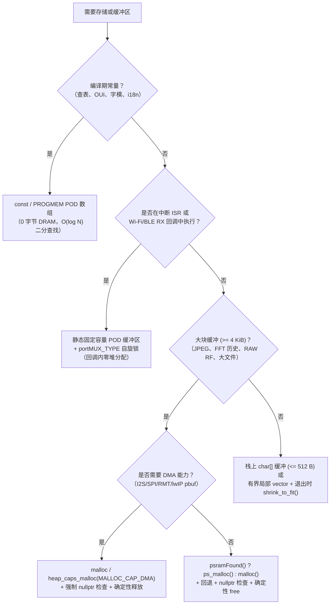

# 内存架构、数据结构与代码审计工程指南

> **语言 / Language:** [English](MEMORY_AND_DATA_STRUCTURES.md) | **简体中文 (Simplified Chinese)**  
> **相关架构文档:** [系统架构与目录规范](ARCHITECTURE_ZH.md) | [ARCHITECTURE.md (EN)](ARCHITECTURE.md)

本文档系统阐述 **哪吒网络安全（Nezha Cyber）** 固件在 ESP32 / ESP32-S3 平台上的内存分层模型、核心数据结构模式、并发安全边界、零卡顿性能工程准则，以及本次代码审计中修复的全部内存与逻辑缺陷。

---

## 1. ESP32 / ESP32-S3 内存分层与开发板规格矩阵

每一项固件设计与数据结构选型都必须**同时兼容**不同规格的开发板——在 8 MB PSRAM 的 ESP32-S3 上运行正常的代码，如果忽视内存层级或 Flash 分区上限，在 4 MB 无 PSRAM 的 ESP32 上可能直接触发 OOM 复位或编译溢出。

| 目标规格档位 | 代表开发板 | Flash 应用分区上限 | 内部 SRAM / DMA DRAM | 外部 PSRAM | 关键构建与内存约束 |
| :--- | :--- | :--- | :--- | :--- | :--- |
| **16 MB + OPI PSRAM 档** | `lilygo-t-deck`（ESP32-S3） | `custom_16Mb.csv` | 总计约 320 KiB DRAM（开机剩余约 180–240 KiB，由 Wi-Fi、NimBLE、SPI/SD/I2S DMA 共享） | 8 MB OPI PSRAM（`CONFIG_SPIRAM_MALLOC_ALWAYSINTERNAL=4096`） | 小于等于 `4 KiB` 的分配仍落在**内部 DRAM**！即便 PSRAM 剩余 7 MB+，高频小对象分配依然会碎片化内部堆并导致 Wi-Fi/BLE 初始化失败。 |
| **8 MB / 中阶档** | `m5stack-cardputer`、`lilygo-t-embed-cc1101`（ESP32-S3） | `custom_8Mb.csv` / `custom_16Mb.csv` | 约 320 KiB DRAM | 视具体板型而定（无或 2–8 MB） | 严禁假设 `ps_malloc()` 必然成功，必须提供 `malloc()` 回退与 `nullptr` 校验。 |
| **4 MB 无 PSRAM 档** | `m5stack-cplus1_1`（ESP32） | `0x3E8000`（约 4.0 MB 上限） | 约 320 KiB DRAM（启用屏幕与射频后仅余约 120–160 KiB） | **无**（`psramFound() == false`） | 启用 `BRUCE_COMPACT_CJK_FONT=1`、`-Os -flto`，严禁引入 `<iostream>` 等重型 C++ 运行时膨胀。 |

### 内存分配决策流

---

## 2. 核心数据结构与架构设计模式

### 2.1 零 DRAM 占用的 Flash 驻留有序查表（`O(log N)`）
禁止声明 `static const std::pair<String, String>` 或 `std::map<String, ...>` 类型的静态查表。Arduino `String` 构造函数会在首次调用时于内部 DRAM 堆上分配大量小块内存且永不释放。

- **标准模式**：使用定长 POD 结构体或 `const char *` 常量表直接驻留 Flash（`.rodata` / `PROGMEM`），通过零分配指针前缀比较或二分查找进行检索。
- **典型实现**：
  - `src/core/lang_zh_cn.h` + `src/core/i18n.cc`：严格按 ASCII 排序的译文表，`O(log N)` 二分查表。
  - `src/modules/ble/BLE_Suite.cc`（`SAMSUNG_MAC_OUIS` + `isSamsungMacCstr()`）：在已排序的 `const char *` 表上直接执行忽略大小写的 `O(log N)` 二分查找，每次 BLE 广播回调零 `String` 堆分配。
  - `src/modules/wifi/deauther.cc`（`OuiEntry kOuiList[]` + `ouiPrefixEquals()`）：将 38 条堆分配的 `std::pair<String, String>` 替换为 Flash 驻留 POD 表与零拷贝 8 字节前缀匹配。

### 2.2 锁安全、零堆分配的射频回调捕获缓冲
ESP-IDF Wi-Fi 混杂模式回调（`esp_wifi_set_promiscuous_rx_cb`）运行在 Core 0 的 Wi-Fi 驱动任务中。在回调里直接调用 `std::vector::push_back`、构造 Arduino `String` 或修改共享 UI 容器，极易引发堆损坏、跨核数据竞争与 DRAM 耗尽。

- **标准模式**：在 RX 回调内仅向受 `portMUX_TYPE` 自旋锁保护的固定容量静态 POD 数组写入极简字段（如 6 字节 MAC + 1 字节 RSSI），待 `esp_wifi_set_promiscuous(false)` 停止抓包后再一次性转换为完整 UI `Host` 列表。
- **典型实现**：`src/modules/wifi/deauther.cc`（`RawDetectedClient[64]`，总计仅占 512 字节，`portENTER_CRITICAL(&clientSnifferMux)`）。去重直接采用 6 字节 `memcmp`，避免每帧重复解析字符串 MAC。

### 2.3 带优先级淘汰策略的有界容器
无上限的扫描列表（未设上限的 `std::vector`）在密集射频环境（机场、办公区、展会等存在数百个随机旋转 BLE MAC 的场景）中必然撑爆内部 DRAM。

- **标准模式**：为扫描表设置确定性上限（例如 `MAX_SCANNER_DEVICES = 64`）；满容时淘汰信号最弱（RSSI 最低）的非高优设备（优先保留 FastPair/HFP 目标），在严格锁定峰值内存的同时确保近距离高价值目标绝不丢失。
- **互斥锁纪律**：包括快照缓存命中判断在内的全部读写操作都必须位于同一 `SemaphoreHandle_t` 临界区内；调用方必须读取 `snapshot->count`，禁止无锁读取底层容器 `.size()`。
- **典型实现**：`src/modules/ble/BLE_Suite.cc`（`ScannerData::addDevice`、`ScannerData::getSnapshot`、`ScannerData::clear`）。

### 2.4 PSRAM 优先大缓冲、`std::nothrow` 与确定性释放
大块瞬态缓冲区（JPEG 图像载荷、Sub-GHz RAW 时序数组、音频 FFT 瀑布图历史、`AsyncWebServer` 对象）应优先使用 PSRAM，在 4 MB 无 PSRAM 板卡上优雅回退至内部 DRAM，并**始终**使用非抛异常路径（`new (std::nothrow)` 或 `ps_malloc`/`malloc`）配合显式 `nullptr` 判断。

- **典型实现**：
  - `src/core/display.cc`：`showJpeg()` 采用 `ps_malloc` → `malloc` 回退 + 整块 `picture.read(data_array, data_size)` + 确定性 `free()`。
  - `src/core/wifi/webInterface.cc`：`startWebUi()` 在 placement `new (server) AsyncWebServer(...)` 前严格检查 `ps_malloc` → `malloc` 结果，`stopWebUi()` 增加 `if (server != nullptr)` 防护。
  - `src/modules/rf/rf_send.cc`：RAW `.sub` 发射改用 `ps_calloc` → `calloc` 回退 + 空指针保护 + OOM 时调用 `deinitRfModule()` 释放硬件。

### 2.5 RAII 资源与硬件生命周期归属
每一块堆内存、文件句柄（`File`）、lwIP `pbuf`、RMT 通道、FreeRTOS 队列以及硬件总线租约（`I2CLease`、`acquireSPIBus`）都必须具备单一明确的所有者，并保证在**所有退出路径**（含提前报错返回与用户按 `ESC` 取消）上完整释放。

- **强制准则**：
  - 构造器中必须将所有拥有权原始指针初始化为 `nullptr`（如 `Gif::gif`、`DHCPStarvation::p/netif`、`MACFlooding::p/netif`）。
  - `free()` / `pbuf_free()` 必须位于最后一次读取缓冲区**之后**，杜绝释放后使用（Use-After-Free）。
  - `LOCK_TCPIP_CORE()` 必须在每一条提前 `return` 分支配对 `UNLOCK_TCPIP_CORE()`，严防死锁。
  - 离开高内存视图时调用 `clear(); shrink_to_fit();` 将峰值容量归还堆分配器（`fileList`、`ScrollableTextArea`、`ScannerData`、`detectedClients`、`RawRecording`）。

### 2.6 两级射频 DMA 内存守卫 (`src/core/radio_mem.h`)
Wi-Fi 与 NimBLE 协议栈强制依赖连续的内部 DMA 能力 DRAM（`MALLOC_CAP_DMA`），无法使用 PSRAM。所有无线模块启动前必须经过统一闸门：
- `radioHasMemForWifi()`
- `radioHasMemForBle()`
- `radioSafeBleInit()`

### 2.7 禁止引入重型 C++ 标准库膨胀
- **严禁在固件 `.cc`/`.h` 中包含 `<iostream>`、`<iomanip>`**：哪怕从未使用 `std::cout`，包含 `<iostream>` 也会向目标文件注入 `std::ios_base::Init` 静态构造函数，显著膨胀 Flash 并在启动时永久占用静态 DRAM。
- **避免用 `<sstream>` 处理简单十六进制/数字解析**：改用 `sscanf`、`strtol`、`strtoul` 与小型栈上 `char[]` + `snprintf`。

---

## 3. 兼顾内存友好与零卡顿体验的性能准则

优秀的嵌入式内存架构设计不仅节省 RAM，更会**显著提升** UI 与应用响应速度：

| 优化手段 | 内存收益 | 响应速度 / UX 收益 |
| :--- | :--- | :--- |
| **将 `fft_init()` 提到 `while(1)` 循环外**（`mic.cc`） | 消除每秒 ~60 次堆分配/释放造成的 DRAM 碎片 | 避免每帧重复计算三角旋转因子 → 音频频谱瀑布图更顺滑 |
| **整块读取 `picture.read(buf, size)`**（`display.cc`） | PSRAM 单块有界缓冲，保护内部 DMA 堆 | JPEG 读取速度较逐字节 `picture.read()` 提升约 15–20 倍 |
| **零分配 `strtol`/`strtoul` 解析**（`custom_ir.cc`、`rf_send.cc`、`ARPScanner.cc`） | 消除数百至数千个瞬态 `String::substring()` 堆块 | 红外与 Sub-GHz RAW 发射瞬时启动，无堆分配器停顿 |
| **`const char*` 有序二分查表**（`BLE_Suite.cc`、`i18n.cc`） | 每个 BLE 广播包 / UI 文本零临时 `String` 分配 | BLE 设备过滤更迅捷、列表滚动更跟手 |
| **仅在退出视图时 `shrink_to_fit()`**（`sd_functions.cc`、`BLE_Suite.cc`、`scrollableTextArea.cc`） | 离开大列表后立即把 DRAM 归还给 Wi-Fi/BLE | 浏览滚动过程中零重复扩容卡顿 |

---

## 4. 固件逻辑与内存审计修复清单（`fix/memory-arch-audit`）

下表记录了本次全仓深度审计定位并修复的所有核心缺陷（严格限定于逻辑、内存安全与数据结构层，**零 UI 样式变动、零 UX 降级**）：

| 子系统与文件 | 审计发现的问题 | 严重程度 | 修复方案 |
| :--- | :--- | :--- | :--- |
| **核心文本滚动视图** `src/core/scrollableTextArea.cc` | `getLine()` 越界读取 `linesBuffer[linesBuffer.size()]`；`scrollToLine()` 在总行数小于可见行数时发生 `size_t` 无符号下溢；单参构造函数未初始化 `_indentWrappedLines` 与 `lastVisibleLine`；`fromFile()` 缺少低内存保护；`clear()` 未归还容量；`_maxCharactersPerLine == 1` 时缩进换行可能死循环。 | 高（越界 / 崩溃 / OOM） | 严格边界钳位 `getLine()` 与 `scrollToLine()`；完整初始化成员变量；保护 `step >= 1`；`fromFile()` 增加 `12 KiB` 剩余堆守卫；`clear()` 调用 `shrink_to_fit()`。 |
| **核心显示与媒体解码** `src/core/display.{h,cc}` | `Gif::Gif()` 未初始化 `gif` 指针（提前失败返回时 `~Gif()` 释放野指针）；重复 `openGIF()` 泄漏旧实例；`getLastError()` 及内联 getter 缺少空指针判断；`openFile()` 把无效 `File` 包装进 `new File`；`showJpeg()` 在 DRAM 使用会抛异常的 `new uint8_t[]` 且逐字节无界读取。 | 高（崩溃 / 泄漏） | `Gif::Gif()` 初始化 `gif(nullptr)`，使用 `new (std::nothrow)` 并在失败/重开时清理，全部 getter 增加空检查；`showJpeg()` 改为 PSRAM 优先 `ps_malloc` + `malloc` 回退及有界整块 `picture.read()`。 |
| **核心文件系统** `src/core/sd_functions.cc` | `createNewFile()` 处理无扩展名文件时因 `extIndex == -1` 破坏文件名且未判空 `fs`；`copyToFs()` 提前返回泄漏 `source`/`dest` 且未检查 `malloc(1024)`；`readBigFile()` 分配失败泄漏 `file` 且忽略 `file.read()` 实际返回字节数；全局 `fileList` 永不缩容。 | 高（句柄泄漏 / 崩溃 / 文件名损坏） | 修复无扩展名拼接与 `fs` 判空；所有错误分支关闭 `File` 并检查 `buff`；严格累加 `file.read()` 实际字节数；退出时对 `fileList`/`sdOptions` 执行 `shrink_to_fit()`。 |
| **核心 WebUI 与网络工具** `src/core/wifi/webInterface.cc` `src/core/net_utils.cc` `src/core/mykeyboard.cc` | `startWebUi()` 未检查 `ps_malloc`/`malloc` 即执行 placement `new (server)`；`stopWebUi()` 未判空 `server`；`net_utils.cc` 为 `stringToMAC()` 引入 `<sstream>`、HTTP 200 成功分支遗漏 `http.end()` 且 `indexOf` 未判 `-1`；`checkShortcutPress()` 未判空 JSON 键值。 | 高（空指针解引用 / 泄漏 / 膨胀） | `startWebUi()` 增加 PSRAM→DRAM 回退与空检查，`stopWebUi()` 判空；`net_utils.cc` 移除 `<sstream>` 改用 `sscanf` 与栈 `snprintf`，补齐 `http.end()` 与 `indexOf` 校验；补全快捷键空指针保护。 |
| **以太网模块套件** `src/modules/ethernet/ARPSpoofer.cc` `ARPoisoner.cc`, `ARPScanner.cc` `DHCPStarvation.{h,cc}` `MACFlooding.{h,cc}` | **释放后使用（UAF）**：`ARPSpoofer` 与 `ARPoisoner` 均先调用 `pbuf_free(p)` 再读取 `p->payload`/`p->tot_len` 写入 PCAP；**反向 `memcpy`**：`ARPSpoofer` 错写 `memcpy(mac, myMAC, 6)`；**lwIP 死锁**：`ARPScanner::setup()` 三条提前返回路径遗漏 `UNLOCK_TCPIP_CORE()` 且未检查 `hostslist_eth.end()`；**越界拷贝**：`DHCPStarvation` 颠倒 `UDP_HLEN` 与 `DHCP_HDRLEN` 并在失败时解引用空 `p`/`netif`；**TTL=0 缺陷**：`MACFlooding` 将 `htons(0x40)` 截断为 `uint8_t` 导致 `0x00`；全部 5 个文件残留无用 `<iostream>`/`<iomanip>`/`<sstream>`。 | 严重（UAF / 死锁 / 缓冲区越界） | 将 `pbuf_free(p)` 移至 PCAP 写入之后；修正 `memcpy(myMAC, mac, 6)`；补齐所有早退路径 `UNLOCK_TCPIP_CORE()` 并校验网关迭代器；用 `strtoul` 替代 `<sstream>` + `try/catch`；修正 DHCP 拷贝长度、TTL `0x40`、空 `p`/`netif` 防护与 `ARPoisoner` 看门狗让步；彻底移除无用 `<iostream>`/`<iomanip>`/`<sstream>`。 |
| **Wi-Fi Deauther 与握手破解** `src/modules/wifi/deauther.cc` `src/modules/wifi/wifi_recover.cc` | `deauther.cc` 包含无用 `<iostream>`/`<iomanip>`/`<sstream>`，在 DRAM 堆上常驻 38 对 `std::pair<String, String>`（含重复键 `"00:1A:2B"`），且在 Wi-Fi 混杂 RX 回调中无锁修改 `std::vector<Host>`；`WordlistReader::nextLine()` 遇到超过 8192 字节的无换行长行会陷入死循环。 | 高（并发竞争 / 膨胀 / 死循环） | 移除重型头文件；OUI 表迁至 Flash 驻留 POD 数组；RX 回调改为自旋锁保护的 `RawDetectedClient[64]` 零分配 POD 缓冲并在退出时 `shrink_to_fit()`；修复 `WordlistReader::nextLine()` 超长行死循环。 |
| **BLE 套件** `src/modules/ble/BLE_Suite.cc` | `ScannerData` 6 个并行 `vector` 无上限增长；`getSnapshot()` 在互斥锁外读取 `snapshotCache`（与 `addDevice()` 删除缓存存在竞争）；调用方读取无锁 `scannerData.deviceAddresses.size()` 而非 `snapshot->count`；`clear()` 未释放容量；`isSamsungDevice()` 每次创建 `String` 线性扫描。 | 高（竞态 / OOM / 越界） | 限制 `ScannerData` 上限 64 项并引入 RSSI/优先级淘汰；将缓存命中判断移入互斥锁内并改用 `new (std::nothrow)`；统一读取 `snapshot->count`；`clear()` 执行 `shrink_to_fit()`；Samsung OUI 校验升级为零分配 `O(log N)` 二分查找。 |
| **音频、红外与射频模块** `src/modules/others/mic.cc` `src/modules/ir/custom_ir.cc` `src/modules/rf/record.cc` `src/modules/rf/rf_send.cc` | `mic.cc` 每帧反复 `fft_init()`/`fft_destroy()` 且部分分配失败时泄漏缓冲、I2S 与 GPIO0 hold；`custom_ir.cc` 未判空 `malloc` 且 `String::remove()` 存在 `O(N^2)` 堆抖动；`record.cc` 按 `ESC` 提前退出时泄漏全部已录制的 `recorded.codes`、缺少 `malloc` 判空且早退未调用 `deinitRfModule()`；`rf_send.cc` 未判空 `calloc`、存在 `index == -1` 回绕 Bug 与逐采样 `String::substring()` 分配风暴。 | 高（泄漏 / 崩溃 / 堆抖动） | 将 `fft_init()` 提升至循环外并在分配失败时完整清理硬件与内存；新增 `clearRawRecording()` 覆盖所有退出路径并补全 `malloc`/`deinitRfModule()` 防护；使用零分配 `strtoul`/`strtol` + PSRAM 优先 `ps_calloc` + 空检查重写 IR 与 RF RAW 解析器。 |
